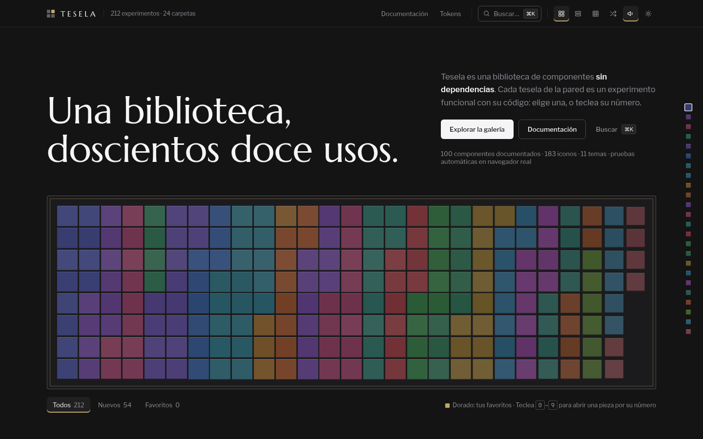
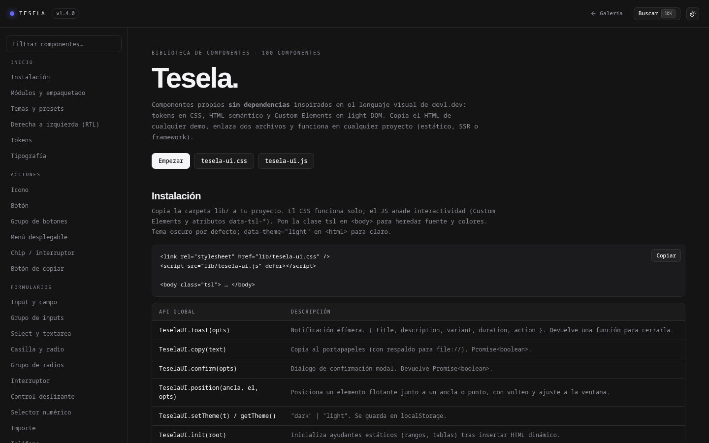

# Tesela

**Biblioteca de componentes sin dependencias**: HTML semántico, CSS con tokens y Custom Elements en light DOM. Funciona en un sitio estático, en SSR o dentro de cualquier framework, sin build ni runtime propio.

[](https://ludaisca.github.io/Tesela/)
[](LICENSE)
[](package.json)
[](https://ludaisca.github.io/Tesela/components.html)
[](CHANGELOG.md)

**[Galería](https://ludaisca.github.io/Tesela/)** · **[Documentación](https://ludaisca.github.io/Tesela/components.html)** · **[Referencia completa](docs/REFERENCIA.md)**



## Qué es

Una biblioteca de componentes para interfaces en español, pensada para copiarse y no para atarse a un framework. Son **100 componentes documentados**, **183 iconos** y **11 temas** sobre 37 tokens de diseño, más una galería de **212 experimentos funcionales** que se pueden abrir, inspeccionar y copiar.

Todo el CSS vive en capas (`@layer tesela.*`), así que tu propio CSS gana sin `!important` ni peleas de especificidad. Los componentes de formulario son *form-associated*: aparecen en `FormData`, respetan `required`, `form.reset()` y `<fieldset disabled>`.

## Empezar

Copia la carpeta `lib/` a tu proyecto y enlaza los dos archivos:

```html
<link rel="stylesheet" href="lib/tesela-ui.css" />
<script src="lib/tesela-ui.js" defer></script>

<body class="tsl">
  <button class="tsl-btn tsl-btn--primary">Guardar</button>
  <tsl-tabs>
    <div class="tsl-tabs__list">
      <button class="tsl-tabs__tab" data-tab="resumen">Resumen</button>
      <button class="tsl-tabs__tab" data-tab="detalle">Detalle</button>
    </div>
    <div class="tsl-tabs__panel" data-panel="resumen">…</div>
    <div class="tsl-tabs__panel" data-panel="detalle">…</div>
  </tsl-tabs>
</body>
```

- El CSS funciona solo: tokens `--tsl-*` y clases `tsl-*`.
- El JS añade los Custom Elements (`<tsl-tabs>`, `<tsl-select>`, `<tsl-toast>`…) y los atributos `data-tsl-*` para diálogos, temas y tablas ordenables.
- Tema oscuro por defecto. `data-theme="light"` en `<html>` para el claro, `system` para seguir al sistema operativo.

## Componentes

| Familia | Ejemplos |
| --- | --- |
| **Acciones** | botón, icono, chip, menú, menú contextual, copiar |
| **Formularios** | input, textarea, select, combobox, casilla, radio, interruptor, OTP, tags, dropzone, subida con progreso, editor enriquecido, importe, teléfono |
| **Fecha y selección** | calendario, selector de fecha, rango, hora, slider, rating, color, grupo de toggle |
| **Navegación** | tabs, barra lateral, barra de menús, menú de navegación, paleta de comandos |
| **Datos** | tabla de datos, kanban, tree view, lista virtualizada, listas ordenables, gráficas de línea, área, barras, dona, gauge, mapa de calor, sparkline |
| **Superficies** | diálogo, sheet, drawer, popover, hover card, confirmación, toast |
| **Conversación** | mensaje, burbuja, adjunto, traza, bloque de código, entrada de prompt, sugerencias, razonamiento, fuentes y citas, versiones, cuestionario, medidor de contexto |
| **Patrones** | panel de control, autenticación, ajustes, alta por pasos, chat con asistente |

La pestaña **API** de cada componente en la documentación lista atributos, propiedades, métodos y eventos, generados desde el mismo manifiesto que los tipos de TypeScript.



## Temas y tokens

- **Tokens**: 37 variables definidas una sola vez en `src/tokens/tokens.json` y exportadas a CSS, Sass, JS y un preset de Tailwind.
- **Presets**: `tesela`, `esmeralda`, `ambar`, `cielo`, `rosa`, `violeta`, `medianoche`, `papel`, `alto-contraste`, `brutalista` y `suave`.
- **Acento en vivo**: `TeselaUI.setAccent("#10b981")` elige solo un texto legible.
- **Sin parpadeo**: `lib/theme-init.js` aplica tema, preset y acento guardados antes del primer pintado.
- **RTL**: `TeselaUI.setDirection("rtl")` espeja los componentes con propiedades lógicas.
- **Iconos**: 183 de Lucide incluidos en línea, más adaptadores para Tabler, Phosphor, Heroicons, Material Symbols y Simple Icons.

```js
TeselaUI.setPreset("esmeralda");
TeselaUI.registerIconLibrary("tabler", TeselaUI.iconLibraries.tabler());
TeselaUI.toast({ title: "Guardado", description: "Los cambios ya están en el servidor." });
```

## Accesibilidad

Cada sección de la documentación pasa **axe-core (WCAG 2.2 AA)** en tema oscuro y claro. Además: roles ARIA, navegación completa por teclado, `<dialog>` nativo, respeto por `prefers-reduced-motion` y soporte de alto contraste (`forced-colors`).

## Estructura

```
lib/                 biblioteca compilada (lo único que hay que copiar)
src/                 código fuente: un módulo por componente
components.html      documentación interactiva
index.html           galería de 212 experimentos
tests/               pruebas en Chromium real con Playwright
docs/                referencia, plan maestro e imágenes
```

## Desarrollo

Requiere Node 18+ solo para compilar y probar; el sitio en sí es estático.

```bash
npm install
npx playwright install chromium

npm run build        # src/ → lib/
npm test             # pruebas en navegador real
npm run icons        # regenera el set base desde Lucide
```

`lib/` está versionado y la CI falla si queda desfasado de `src/`, así que compila antes de hacer commit. Para ver el sitio en local, sirve la raíz con cualquier servidor estático (`python3 -m http.server 24100`) o con `docker compose up`.

## Licencia

[MIT](LICENSE) © 2026 Luis Islas.

Los iconos del set base provienen de [Lucide](https://lucide.dev) y se distribuyen bajo licencia ISC, incluida en `lib/LICENSE-lucide.txt`.
